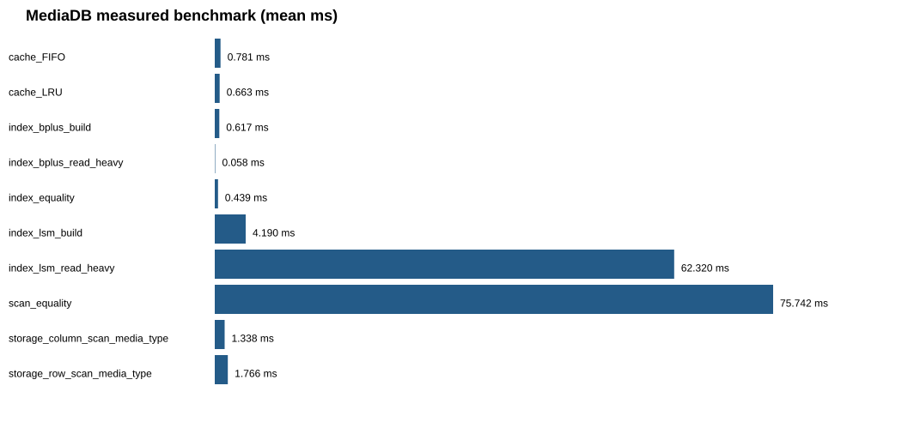

# MediaDB

**A lightweight database engine for media-asset metadata, built with custom storage and indexing primitives.**

MediaDB explores how a database works under the hood: persistent page files, a configurable buffer pool, row and column storage layouts, B+ tree and LSM tree indexes, content-addressed object storage, and a focused query interface. The demo workload contains **synthetic** video, image, and audio metadata.

> **Status:** Working storage-and-indexing prototype with automated tests and reproducible microbenchmarks. This is **not** a production DBMS: transactional updates, crash recovery, concurrent writes, general SQL, joins, and distributed consensus are not implemented.

## Features

| Component | Implementation |
| --- | --- |
| Durable pages | Custom fixed-size 4 KiB disk pages; page/slot record identifiers |
| Page cache | FIFO and LRU replacement, write-back, cache hit/miss and page-I/O counters |
| Storage formats | Row-oriented and column-oriented record layouts |
| B+ tree | Equality and inclusive range lookup, node splits, linked leaves, duplicate keys |
| LSM tree | In-memory write buffer, sorted runs on disk, compaction and restart support |
| Index strategy | Explicit read/write workload heuristic to select between index types |
| Blob storage | SHA-256-addressed local binary objects with pluggable codec hook |
| Query interface | Restricted SQL-like `SELECT` with equality and `BETWEEN` predicates |
| Validation | Unit/integration tests plus repeatable benchmarks and raw result files |

## Architecture

```text
Media asset metadata / CLI
            |
     MediaDatabase API
        /       \
Custom storage  Secondary indexes
      |         |-- B+ tree (rebuilt on start)
      |         |-- LSM tree (durable sorted runs)
      |         `-- Workload selection rule
      |-- Row store
      |-- Column store
      `-- FIFO/LRU buffer pool
                |
         4 KiB page files

Other: local content-addressed binary object store + codec extension point
```

The engine implements its own storage and indexes; it does **not** use PostgreSQL, SQLite, MySQL, MongoDB, or another DBMS as an implementation dependency. The engine and tests use only Python's standard library.

## Run locally

**Requirements:** Python 3.10 or newer. From the repository root:

```bash
python3 --version
python3 -m unittest discover -s tests -v
python3 -m mediadb --db demo_database demo
python3 -m mediadb --db demo_database query "SELECT * FROM media WHERE media_id = M002"
python3 -m mediadb --db demo_database query "SELECT * FROM media WHERE media_id BETWEEN M001 AND M003"
python3 -m mediadb --db demo_database stats
```

Rerun a query after closing the process to check that the data survives a normal restart. B+ tree indexes are rebuilt from durable pages; LSM runs are written to disk.

Additional index example:

```bash
python3 -m mediadb --db demo_database index size_bytes --kind auto --read-fraction 0.9
python3 -m mediadb --db demo_database query "SELECT * FROM media WHERE size_bytes BETWEEN 1000 AND 2000"
```

This is a **deliberately limited** SQL-like grammar, not full SQL. See the [architecture notes](docs/ARCHITECTURE.md) for internals and limitations.

## Reproducible benchmarks

```bash
python3 scripts/benchmark.py --records 600 --runs 5 --out results
```

The benchmark compares FIFO/LRU behavior, row/column scans, index lookup versus full scan, and isolated B+ tree / LSM tree operations. Every run exports `results/raw_trials.csv`, `results/summary.json`, and an SVG chart with **actual measured timings**.



Included results describe the execution environment in their metadata, **not** a claim of performance on any particular user's device. See [benchmark methodology](docs/BENCHMARKS.md) for the measured conditions and important fairness caveats.

## Repository layout

```text
mediadb/               Storage engine, indexes, object store, database facade and CLI
scripts/benchmark.py   Benchmark runner and exports
examples/              Usage examples
 tests/                Automated correctness and integration checks
 docs/                 Architecture, benchmark notes, engineering roadmap
 results/              Example run with raw measurements and charts
```

## Known limitations

- Insert/read workflows only; updates, deletion and atomic multi-record commits are not implemented.
- B+ tree nodes are in memory and rebuilt at startup; LSM sorted runs persist to disk. Their build times are **not** durability-equivalent measurements.
- The default `IdentityCodec` is **not encryption**. The codec API is an extension point only.
- No WAL, crash recovery, transaction isolation, concurrency coordination, general JOIN execution, or distributed cluster support.
- Demo and benchmark metadata are synthetic; no actual copyrighted media is distributed.

See the [engineering roadmap](docs/ROADMAP.md) for possible next steps.

## License

A license has not been selected. Public visibility alone does not grant permission to reuse or redistribute the code; the repository owner can choose a license before accepting contributions.
